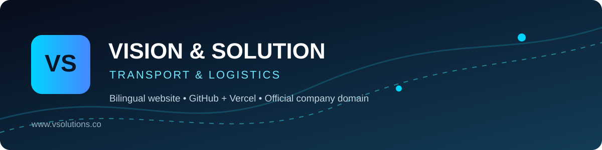
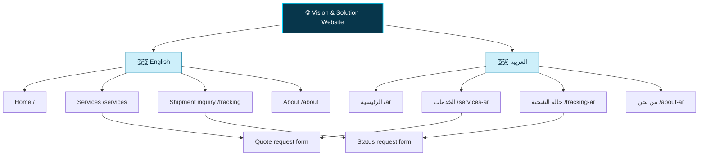
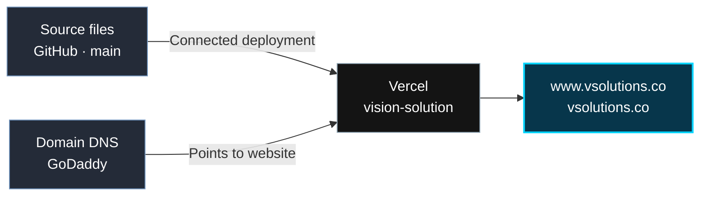

<div align="center">



# Vision & Solution — Transport & Logistics
### رؤى وحلول | النقل والخدمات اللوجستية

**Official bilingual company website · Saudi Arabia**

[](https://www.vsolutions.co/)
[](https://vercel.com/)
[](#-language--page-directory)
[](#-technical-overview)

**[🌐 Visit official website](https://www.vsolutions.co/)** &nbsp; · &nbsp; **[🇸🇦 Arabic](https://www.vsolutions.co/ar)** &nbsp; · &nbsp; **[🇬🇧 English](https://www.vsolutions.co/)**

</div>

---

## ✨ Project overview | نبذة عن المشروع

This repository contains the **public-facing bilingual website** of **Vision & Solution Transport & Logistics**. Visitors can learn about the company, explore its services, request a transport quotation, and send a shipment-status inquiry.

هذا المستودع يحتوي على **الموقع التعريفي الرسمي لشركة رؤى وحلول للنقل والخدمات اللوجستية**، مع صفحات عربية وإنجليزية لعرض الخدمات وطلب عروض الأسعار والاستفسار عن حالة الشحنات.

> **Scope:** This is a corporate website — **not** the separate transport management system. The shipment-status page submits an inquiry; it does **not** offer automated live tracking at present.

## 🧭 Explore the website

| Section | English | العربية | Purpose |
|:--|:--|:--|:--|
| 🏠 Home | [Open](https://www.vsolutions.co/) | [فتح](https://www.vsolutions.co/ar) | Company identity and introduction |
| 🚚 Services / quotation | [Open](https://www.vsolutions.co/services) | [فتح](https://www.vsolutions.co/services-ar) | Submit transport quote requests |
| 📦 Shipment status | [Open](https://www.vsolutions.co/tracking) | [فتح](https://www.vsolutions.co/tracking-ar) | Submit a shipment-status inquiry |
| ℹ️ About | [Open](https://www.vsolutions.co/about) | [فتح](https://www.vsolutions.co/about-ar) | Company background |

## 🗺️ Site map / خريطة الموقع



## 🏗️ Architecture & deployment



| Component | Implementation |
|:--|:--|
| Site type | Static, multi-page website |
| Markup / styling | HTML + CSS, with page-level styling |
| Languages | English (LTR) and Arabic (RTL) |
| Hosting | Vercel, project `vision-solution` |
| Source control | GitHub, branch `main` |
| Official URL | **https://www.vsolutions.co/** |
| Domain administration | GoDaddy |
| Quote / status submissions | FormSubmit email form integration (not a custom backend) |
| Routing | `vercel.json` rewrites for friendly URLs |

### 🔄 Publishing flow

1. Changes to the website source are committed to the connected GitHub repository.
2. Vercel builds/deploys the connected project.
3. The configured production domain serves the deployed website.

**Important:** A successful deployment does not by itself guarantee every form or external integration works; test them after any relevant change.

## 📁 Repository structure

```text
V-SOLIOTION-/
├── README.md                 # You are here
├── docs/
│   └── brand-banner.svg      # GitHub-only README artwork
├── index.html                # Root website entry point
├── vercel.json               # Friendly URL rewrites
└── vison/
    └── new/
        ├── index.html        # English homepage
        ├── ar.html           # Arabic homepage
        ├── services.html     # English quote request
        ├── services-ar.html  # Arabic quote request
        ├── tracking.html     # English status request
        ├── tracking-ar.html  # Arabic status request
        ├── about-en.html     # English about
        ├── about.html        # Arabic about
        ├── logo.svg
        ├── favicon.png
        └── ...               # Additional image assets
```

> ⚠️ The existing folder is deliberately spelled `vison` (without the second 'i'). This is a **legacy path** referenced by current files and routing. Renaming it without updating references could break the site.

## 🛠️ Working on the site

### Preview locally

For a convenient preview from the repository root, start a basic static web server (Python 3 example):

```bash
python -m http.server 8000
```

Open `http://localhost:8000/`. The site uses absolute URL paths such as `/services` that are rewritten by **Vercel** in production; those friendly routes may not work in a plain local static server. For accurate routing behavior, use a Vercel-compatible local preview.

### Safe-change checklist

- Review English **and** Arabic pages for consistency.
- Preserve existing public routes and `<base href="/vison/new/">` behavior.
- Check mobile navigation, page links, and asset loading.
- Test quotation and shipment-status forms without submitting real customer data during development.
- Check the Vercel production deployment after changes.
- Do not place secrets, API keys, or personal customer details in this public repository.

## 📌 Project notes

- The official website is **https://www.vsolutions.co/**, **not** the former GitHub Pages address.
- The Vercel `/tracking` page is a **shipment-status request form**, not a live tracking dashboard.
- The company transport-management platform is maintained as a **separate application**; this repository documents only the corporate site.
- The README's infographic and banner are documentation-only files and do not modify the production site's look.

---

<div align="center">

### Vision & Solution
**Moving your world, mile by mile with safety & trust.**

[**Visit Website ↗**](https://www.vsolutions.co/) &nbsp; | &nbsp; [**View Source ↗**](https://github.com/a7mdel5taeeb-eng/V-SOLIOTION-)

</div>
